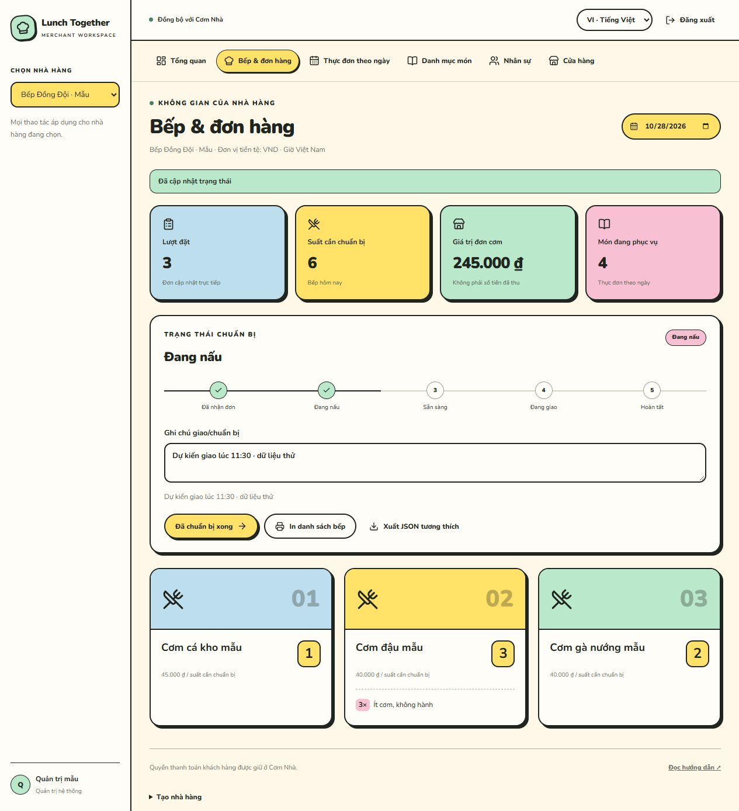

# Lunch Together Merchant

A dedicated restaurant workspace for [Lunch Together / Cơm Nhà](https://github.com/devoralabsapp/lunch-together). Both applications use the same Firebase Authentication project and Firestore **Standard** database. New Google users await administrator approval before opening stores. Approved accounts manage multiple branches, individual menus and scoped staff. Vietnamese and Retro are the defaults; English and six selectable themes are included.



*Actual merchant interface with fictitious local-emulator orders. No production customer data is shown.*

[Open the merchant application](https://lunchtogether-merchant.devoralabs.tech/) · [Implementation prompt](PROMPT.vi.md)

Regular Google accounts belong to one operational portal. A new Merchant login
opens a registration/status screen; only approval unlocks store operations.
Approval switches an ordinary customer account to Merchant. Only verified customer
administrators operate both. Suspended memberships never become customer accounts.
See [approval, branches and themes](docs/APPROVAL-AND-BRANCHES.md) for setup and policy.

## Features

- Daily operational dashboard, real-time aggregated kitchen orders, counted preparation notes and print-ready kitchen lists.
- Shared restaurant catalog across branches, with table-based daily publication. Publish before customer day selection; assigned dates synchronize atomically. Original order prices and financial records are preserved.
- Accepted → cooking → ready → delivering → completed workflow, with role checks and immutable activity events. Changed orders require acknowledgment again; payment-only updates do not reset kitchen acknowledgment.
- Administrator-reviewed registration, approval feedback, suspension and restoration.
- Multiple owned stores, per-branch dated menus and per-store owner/manager/kitchen roles. One person can work at multiple branches.
- Classic, Command Line, Visual Studio Code, Excel, Midnight and Playful Retro Neo-Brutalism themes, with Vietnamese/English copy and retained preferences.
- An isolated, clearly labeled demo that never writes to Firebase. Compatible restaurant-v1 JSON export.
- The customer app receives the restaurant's preparation/delivery status and changed-order warning.

This is an operational meal-coordination application. Meal order value is **not** a record of money collected. Customer payment/refund/credit authorization stays in Lunch Together. Existing customer order visibility remains shared; new merchant management, catalog and activity permissions are scoped by restaurant.

## Run and connect

Node.js **22** and npm are required.

```sh
npm ci
cp .env.example .env.local
npm run dev
```

Fill the Firebase Web configuration from the **same** project as Lunch Together. Use the same Firestore database ID. Never add server credentials, private keys or Firebase Admin SDK. Open [localhost:5190](http://localhost:5190).

1. Deploy the matching customer integration and publish the complete shared Firestore Rules from the customer application. The reference [integration/firestore.rules](integration/firestore.rules) uses `PRIMARY_ADMIN_UID_HERE`; preserve the existing operator's primary UID before publishing. Do not replace live Rules with an unconfigured placeholder or a merchant-only fragment.
2. Add the merchant production hostname to Firebase Authentication → Settings → Authorized domains. Google sign-in must already be enabled.
3. Sign in with an existing Lunch Together administrator. Create a restaurant and optionally assign an initial owner UID. New Google users sign in, complete registration and wait for **Merchant approvals / Phê duyệt Merchant**. Approved owners can create additional stores themselves.
4. Add shared catalog dishes and publish a daily menu for the selected branch/date. Publication does not require a customer date assignment.
5. In Lunch Together, an administrator creates a meal day and selects the restaurant and its published offer. Each date has one immutable assignment. Subsequent publication synchronizes that menu; only the customer administrator controls opening/closing.
6. Customers order in Lunch Together. The restaurant receives live changes and updates preparation/delivery status. Kitchen staff can change cooking/ready steps; managers/owners accept and deliver.

New merchant collections do not require a composite index. A regular customer administrator and an owner are different roles. Global customer administrators can manage all restaurants; a staff identity can have different scoped roles at multiple restaurants.

## Deployment

Import this public GitHub repository into Vercel, select Next.js and Node.js 22, and set the non-empty Firebase Web environment values from `.env.example`. Keep emulator hosts empty on Vercel. Publish the Rules and authorize the final production domain before operational use. Preview deployments should use an isolated Firebase demo/test project if they will write data.

## Validation and development

```sh
npm test
npm run typecheck
npm run build
```

Model tests cover counted notes, v1 snapshot compatibility, normalized dish IDs, kitchen fingerprints and role transitions. Full shared Rules/integration regression tests live in `tests/merchant-firestore.test.ts` in the Lunch Together repository and run with local Auth/Firestore emulators. Read [the integration contract](docs/INTEGRATION.md) and the complete [Vietnamese implementation prompt](PROMPT.vi.md) before continuing development.

## Tiếng Việt

Ứng dụng riêng cho nhà hàng, dùng chung Firebase với Cơm Nhà. Đăng thực đơn từ merchant sẽ cập nhật đúng ngày bên Cơm Nhà; đơn khách đặt/sửa/hủy được cập nhật về bếp. Trạng thái chuẩn bị/giao cơm được gửi ngược lại. Số lượng ghi chú được tính theo suất; không hiện dòng cho suất không có ghi chú. Không cấp thêm quyền thay đổi tiền của khách cho nhà hàng.

Người mới đăng nhập Google chờ quản trị duyệt tại **Phê duyệt Merchant**. Sau khi duyệt có thể tạo nhiều cơ sở và thực đơn riêng; quản trị vẫn liên kết ngày để nhận đơn Cơm Nhà. Nhân sự được cấp quyền riêng theo từng cơ sở. Cần Publish Rules tương thích và thêm hostname merchant vào Authorized domains. Demo dùng dữ liệu giả và không lưu thay đổi.

## License

MIT. Original code maintained by [devoralabsapp](https://github.com/devoralabsapp). See [LICENSE](LICENSE). This repository contains sample data only and does not claim sponsorship or endorsement.

Store management and meal-day linking: [navigation, archives and linked menus](docs/STORES-AND-MEAL-DAYS.md). Desktop navigation is on the left; restaurant selection sits beside the date. The Stores directory offers recoverable deletion and restoration. Lunch Together administrators can create a day manually or from a restaurant’s saved dated menu.

Shared catalog and direct publication: [data model, migration policy and flow](docs/SHARED-CATALOG-AND-MENUS.md).

## Reusable branch menu update

Daily menu now has one Branch menu panel with Publish menu. The latest published menu is reused every day from its effective date until changed. The separate shared-menu panel is removed. See [reusable branch menu](docs/REUSABLE-BRANCH-MENU.md) for current behavior and compatibility.
